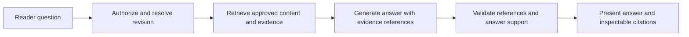

# AI, sources, and grounded evidence

**Status:** Proposed AI architecture and trust behavior. D06, D07, T19, and T20 were adopted 2026-10-22 to unblock implementation, at the user's direction to proceed on the planned defaults; revisit at architecture review.

## AI responsibilities

AI assists with source interpretation, structure, drafting, refinement, audience implications, grounded answers, and aggregate topic summaries. The application controls authorization, publication, canonical content, and deterministic validation.

Use task-oriented interfaces such as composition, revision proposal, answer generation, and topic summarization. Provider-specific APIs and model identifiers belong behind these interfaces.

Per T19, the default provider is deterministic and local: answers are extractive and retrieval-based, and composition preserves the supplied structure. It needs no external model, so reading, publishing, and tests never depend on a live model.

The user chose Anthropic (Claude) as the AI provider (D12). `AnthropicProvider` calls Claude through the official `@anthropic-ai/sdk`: one Messages API request per task, with structured outputs derived from the task's output schema, an explicit per-task effort level, no sampling parameters or prefill, the stable instructions first with prompt caching, and the server-side refusal fallback (`fallbacks: "default"`) enabled. The output is validated again against the full task schema, and reader answers still pass citation and support validation. A model refusal of a reader question is stored as an honest `refused` abstention; a truncated response is never parsed. Rate limits, overloads, server errors and timeouts fail the run with the usual categories, so the domain falls back to the next approved provider (by default the local deterministic one) and reading is unaffected (principle 6). The generic AI SDK adapter (`ai-sdk`) remains for other injected models.

Provider wiring is environment configuration (`CEREBRO_AI_PROVIDER=anthropic`, `CEREBRO_AI_MODEL`, optional per-task model and effort overrides; or `ai-sdk` with `CEREBRO_AI_SDK_MODULE` and `CEREBRO_AI_SDK_EXPORT`; plus embedding and retrieval settings), documented in `packages/ai/README.md`. The default remains deterministic. The model default (`claude-opus-5-5`) and per-task effort levels are provisional implementation settings, to be measured with `npm run ai:eval`; no evaluation threshold is set. An organization must list the provider id (`anthropic`) in its AI policy before its data is sent there.

Anthropic offers no embeddings API, so the embedding source for hybrid retrieval is still an open decision; `CEREBRO_EMBEDDINGS` stays `none` or `local` until one is chosen.

## Incoming LLM authoring

The primary creation workflow receives selected content from an executive's connected LLM through the authenticated integration described in [LLM_INTEGRATION.md](LLM_INTEGRATION.md). This incoming host connection is independent of Cerebro's outgoing model-provider calls.

Accept a schema-valid structured draft or selected material for composition. Preserve the author's position, alternatives, assumptions, risks, open questions, and action plan. Do not automatically rewrite a complete structured draft merely to route it through another model.

Capture only material the host can transfer and the author selects. Complete chat history, hidden reasoning, and original attachments are not guaranteed. Host-provided source titles, URLs, and quotations remain unverified attribution until the supporting material can be checked; a conversation summary alone is not independent factual evidence.

Transferred content uses the private source pipeline. Host-supplied excerpts arrive as evidence candidates; the author approves or excludes each one in preview, and only approved excerpts enter `revision_evidence` and the published reader corpus. A brief with no approved evidence publishes with an explicit "no supporting evidence attached" state. See [LLM_INTEGRATION.md](LLM_INTEGRATION.md#evidence-approval). Attachment-transfer failures and missing support remain visible in the preview. A changed draft invalidates earlier publication previews.

## Source pipeline

1. Validate format, size, and access; store the original privately.
2. Extract text using bounded workers and preserve page, slide, or message locators.
3. Record extraction state and gaps for author review.
4. Store immutable source chunks and provenance.
5. Use explicitly selected sources for composition, and offer excerpts as evidence candidates for author approval.
6. At publication, copy approved excerpts and safe attribution into revision evidence.
7. Build reader retrieval projections from the published document and approved evidence only.

Steps 1–4 for uploaded files arrive in Phase 3. Phase 2 handles host-transferred text and candidate excerpts through the same private-source and approval rules. The initial import scope is pasted text/Markdown and text extraction from PDF, DOCX, and PPTX, plus local OCR for scanned PDF pages and PNG/JPEG/WebP images. Complex chart reconstruction and private conversation-link connectors are deferred.

OCR runs only in the background extraction job, on the server, with bundled language data (English by default) and no cloud OCR service. A PDF page is OCR-read only when its text layer is missing or nearly empty. OCR text is candidate text like any other extraction: its locator says it was machine-read ("p. 3 (OCR, 91% confidence)"), an informational gap tells the author to check it against the original, low-confidence lines are left out and reported as a gap, and page-count, pixel and time limits, failures and timeouts all become gaps rather than errors. OCR never approves evidence.

Imported documents are untrusted input. Processing requires file limits, safe rendering, and appropriate parser isolation. Instructions embedded in sources cannot change permissions or invoke application tools.

## Composition contract

Composition receives the selected source set, document context, intended audience, and desired outcome. It returns a schema-valid proposal with source references and explicit gaps where support is missing.

The author inspects and applies the proposal. Applying an AI edit uses the same draft concurrency checks as manual editing. A result generated against an outdated draft cannot silently overwrite newer work.

Author-written perspectives, supplied in the handoff or edited manually, are part of Phase 2. AI-suggested perspectives follow in Phase 3; they are proposals that the author reviews and adopts before they are stored with the document. Either kind changes emphasis and implications only, never access (D06). The reader does not receive dynamically invented author positions on each visit.

Implementation (W3.3): suggested perspectives (`suggest_perspectives` task) and revision proposals (`propose_revision` task) are stored as pending rows in `briefing_suggestions` (migration 0007), never in the draft. Before a perspective suggestion is stored, and again when it is accepted, it is checked against the draft: emphasis may name only existing sections, implication links only existing blocks, text may not name unknown section, block or evidence ids, and every number must already appear in the draft's stated content (approved evidence only). The author accepts or dismisses each suggestion in the editor. Accepting writes the draft through the same `expectedVersion` check as a manual save; a revision proposal is accepted only against the draft version it was generated for. Publication still requires the normal preview and publish actions. The deterministic provider makes rule-based suggestions that quote the draft and say that no model was used.

## Reader Q&A pipeline

Every retrieval operation is scoped to the authorized organization, briefing, revision, and evidence set before content is supplied to the model. Private source chunks are an authoring resource and are not part of the reader corpus.

Start with full-text retrieval (T20). Add vector retrieval only when an embedding provider is configured, and measure the combination before relying on it. Optimize ranking and indexing from representative evaluations, without weakening authorization predicates. Derived indexes must be invalidated or made unavailable when access or publication state changes.

Implementation (W3.2): an embedding task interface with a deterministic local implementation (hashed bag-of-words, 256 dimensions) for tests and development. When embeddings are configured and the organization allows the embedding provider, an `embed_revision` job fills the vector columns of a published revision's retrieval chunks (published blocks and approved evidence only; private source chunks are never embedded for readers) and records the model and dimensions. Hybrid retrieval, reciprocal rank fusion of the full-text and vector rankings within the revision, is behind `CEREBRO_RETRIEVAL_MODE=hybrid` and defaults off. It compares only vectors from the same model and dimensions, and falls back to full-text when the question cannot be embedded. `npm run ai:eval` reports full-text and hybrid metrics side by side; it does not choose the default.

## Answer behavior

- Identify the revision and selected perspective used for the answer.
- Link claims to approved evidence or published blocks.
- Distinguish what the briefing states from inferred implications.
- State when the material is insufficient or contradictory.
- Offer explicit submission of unresolved questions to the author.
- Do not fabricate evidence IDs, source quotations, or missing numerical values.
- Never substitute an older revision when the requested revision is still indexing.

Reference validation must confirm that cited IDs exist, belong to the authorized revision, and resolve to accessible content. Support evaluation must additionally check that the cited material actually supports the associated claim. Valid IDs alone do not establish factual grounding.

Streaming behavior must distinguish provisional output from a validated completed answer. Failed or interrupted answers retain an honest status and a recoverable retry path.

## Provider policy and observability

Record task, provider, model, prompt version, latency, usage, error category, and relevant resource IDs for each AI run. Do not log full sensitive prompts or source text by default.

Provider routing and fallback must obey organization policy, including permitted vendors and processing regions where applicable. An outage does not authorize sending confidential data to an unapproved provider.

Apply task-specific timeouts, bounded context, rate limits, usage budgets, and retries. Changes to an embedding model require explicit projection versioning and reindexing because vector spaces are not interchangeable.

Implemented fallback: providers are tried in configured order among those the organization's policy allows. A provider that is unavailable, times out, errors or returns invalid output hands over to the next allowed provider, which by default is the local deterministic provider. When none succeeds, reader Q&A stores an honest "answers are unavailable" result, and proposals report that they are unavailable without changing the draft. Every attempt is recorded in `ai_runs` with its error category.

## Reader privacy and topic analysis

Per D07, Q&A is private to the asker, with disclosed aggregate topic analysis. Authors receive explicitly submitted attributed feedback separately.

Privileged analysis jobs may process permitted transcripts for topic aggregation, but author-facing summaries must not expose raw private transcripts, identifying excerpts, or revealing small-cohort information. A topic is suppressed unless it draws on at least 3 distinct readers, a provisional implementation setting. The threshold, retention, and disclosure text require review before pilot use.

## Evaluation set

Use representative executive briefings and intentionally difficult questions to evaluate:

- Directly supported answers and multi-source synthesis.
- Citation resolution and whether evidence supports the claim.
- Missing or conflicting evidence and appropriate abstention.
- Questions that request another tenant's content or private source material.
- Prompt injection inside uploaded sources and questions.
- Revision mismatch, removed evidence, expired access, and provider failure.
- Unsupported numerical precision and invented implications.

Quality targets are set before pilot launch. Provider changes require rerunning the relevant evaluations.

`npm run ai:eval` runs the answer set against every configured provider and the retrieval set (full-text against hybrid) on the fictional strategy briefing. It prints metrics only and writes JSON and Markdown reports to `.data/ai-eval/` (git-ignored). It applies no pass threshold; thresholds remain to be agreed.
