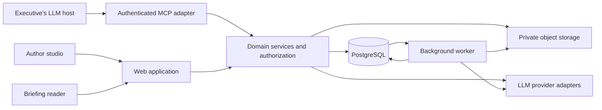

# System architecture

**Status:** Proposed technical architecture. The implementation selections marked below (D08, T07, T16–T22) were adopted 2026-10-22 to unblock implementation, at the user's direction to proceed on the planned defaults; revisit at architecture review.

## Runtime shape

Begin with a modular monolith and a separate background worker. The web application and worker share domain services and authorization rules. This provides explicit boundaries without requiring a distributed service architecture for the MVP.



## Proposed technology stack

| Concern | Choice | Rationale |
| --- | --- | --- |
| Repository | npm workspaces; internal TypeScript-source packages consumed without a build step (T16) | One install and no per-package build pipeline; pnpm is not installed |
| Application | Next.js, React, strict TypeScript 6.0.x (T17) | Server-rendered reader, interactive authoring, and server endpoints |
| UI | Tailwind CSS, Radix primitives, Cerebro-owned components | Accessible foundations with a distinct visual system |
| Editing | Structured block forms; prose (`RichText`) fields use Tiptap trimmed to the RichText syntax: paragraphs, line breaks, bold, italic, http(s) links (T22, W3.4) | Schema-first editing; the stored and published format stays the RichText string |
| Validation | Zod | Runtime contracts for requests, documents, and AI output |
| Persistence | PostgreSQL, Drizzle, SQL migrations; PGlite when `DATABASE_URL` is unset, node-postgres otherwise (T18) | Relational integrity with JSONB content snapshots; repeatable local setup |
| Retrieval | PostgreSQL full-text search first; optional pgvector column populated only when an embedding provider is configured (T20) | Authorized evidence retrieval without a separate search service or a required embedding vendor |
| Authentication | Dev identity adapter locally and in tests; Clerk in production (D08) | Local work without a vendor; hosted authentication in production |
| Authorization | Cerebro-owned organization and briefing policies; see [ACCESS_MATRIX.md](ACCESS_MATRIX.md) | Explicit, portable product permissions |
| AI transport | Task interfaces with a deterministic local provider by default; AI SDK adapter with an injected model (T19) | No live model needed for reading, publishing, or tests; no vendor selected |
| Incoming LLM integration | Remote MCP adapter using `@modelcontextprotocol/sdk` over Streamable HTTP at `/api/mcp` (T21); MCP Apps UI deferred (T14) | Create, preview, publish, and update from a supported LLM host |
| Delegated authorization | Connection tokens locally; established MCP-compatible OAuth authorization server in production, with Clerk OAuth/MCP as the first candidate pending verification (D08) | Account linking and bounded client access |
| Jobs | Node.js worker and a Cerebro-owned PostgreSQL `jobs` table claimed with `FOR UPDATE SKIP LOCKED` (T07) | Transactional enqueue in domain transactions; identical behavior on PGlite and PostgreSQL |
| Assets | Private S3-compatible storage | Source files and derived assets |
| Testing | Vitest, Playwright, database integration tests | Domain, security, and journey verification |
| Operations | Docker, managed PostgreSQL, structured logs, OpenTelemetry | Portable deployment and diagnosable failures |

Exact dependency versions are pinned in the implementation. Hosting vendors, deployment regions, AI models, and embedding providers remain open decisions.

## Environments

| Concern | Local development and tests | Production |
| --- | --- | --- |
| Database | PGlite when `DATABASE_URL` is unset; real PostgreSQL through `docker-compose.yml` or `DATABASE_URL` | Managed PostgreSQL |
| Web identity | Dev identity adapter: seeded users, signed session cookie, dev-only sign-in page disabled unless `AUTH_MODE=dev` | Clerk |
| MCP authorization | Revocable, hashed connection tokens created in Settings | MCP-compatible OAuth authorization server, pending verification |
| AI | Deterministic local provider | Deterministic local provider until a vendor is agreed; AI SDK adapter thereafter |

Runtime-role and RLS tests must also run against real PostgreSQL; PGlite convenience does not replace that evidence.

## Domain boundaries

| Module | Owns |
| --- | --- |
| Identity and access | Companies (organization tenants), departments, teams, memberships, invitations, grants, policy evaluation |
| Capture | Upload validation, extraction, source records, source locators |
| Briefings | Documents, drafts, perspectives, validation, revisions, comparison |
| Publication | Release transaction, sharing, revocation, publication audit |
| Intelligence | Composition, retrieval, answer generation, provider routing |
| Engagement | Feedback, events, topic summaries, unresolved issues |
| Integration adapter | MCP tool contracts, account-link context, authoring preferences, operation results, and optional embedded UI |

Domain services should accept a trusted request or job context, validate input, enforce policies, and return purpose-specific data. UI components and route middleware are not the authorization boundary.

The MCP adapter calls these same services; it is not a separate publication or permission implementation. Initially host its endpoint with the application. Incoming LLM-client connections and outgoing Cerebro model-provider calls are independent boundaries. See [LLM_INTEGRATION.md](LLM_INTEGRATION.md) for contracts and host limitations.

Company, department, and team library queries belong to the briefings module and use the same access policies as the reader. Company is the product-facing term for an organization tenant. Departments and teams are internal structure; published-brief discovery spans them according to audience policy. See [TEAM_WORKSPACES.md](TEAM_WORKSPACES.md).

## Suggested repository organization

This is the planned layout as npm workspaces (T16); it does not record implementation progress:

```text
apps/
  web/                 Application routes and web composition
  worker/              Background job entry points
packages/
  domain/              Domain models, services, and policies
  database/            Database schema, migrations, repositories
  briefing-schema/     Document validation and schema versions
  briefing-renderer/   Shared preview and reader rendering
  ui/                  Tokens and reusable interface components
  ai/                  Provider adapters and task contracts
  integrations/        MCP contracts, adapter, and optional host UI
llm-docs/              Project planning and architecture
```

Keep package boundaries useful and small. A package split must not create circular dependencies or require a service deployment for every domain.

## Request and job handling

- Resolve identity server-side, then establish the organization and resource permissions.
- Validate input at every externally callable mutation or query boundary.
- Perform database work with transaction-local authorization context.
- Return only the fields the calling experience may access.
- Enqueue durable jobs in the transaction that creates the corresponding work.
- Give jobs idempotency keys and persist progress and failure states.
- Recheck relevant access and resource state when jobs execute; an enqueue-time permission is not permanent authority.
- Keep extracted text and model payloads out of general application logs.
- Bind publication to the reviewed draft, evidence, home, and audience; revalidate access and idempotency on every integrated mutation.
- Return an operation reference for asynchronous integration work; authorize polling and retry recovery just like the originating request.

## Reliability and deployment

The initial deployment consists of the web service, worker, database, and private object storage. Use separate production and non-production environments, managed secrets, migrations, health checks, and tested backups.

AI jobs need bounded retries, timeouts, cancellation or supersession behavior, and usage limits. A retried job must not create duplicate revisions, feedback, or publication effects.

Reader rendering must not depend on a live model request. Published content is served from stored snapshots; Q&A is an optional contextual interaction.

## Reference basis

- [Next.js authentication guidance](https://nextjs.org/docs/app/guides/authentication) supports centralizing authorization close to data access.
- [Tiptap custom extensions](https://tiptap.dev/docs/editor/extensions/custom-extensions) support domain-specific editing structures.
- [AI SDK provider management](https://ai-sdk.dev/docs/ai-sdk-core/provider-management) supports a provider registry behind application-owned interfaces.
- [Drizzle row-level security](https://orm.drizzle.team/docs/rls) documents PostgreSQL policy integration.
- [PostgreSQL locking clauses](https://www.postgresql.org/docs/current/sql-select.html#SQL-FOR-UPDATE-SHARE) document `SKIP LOCKED`, used by the `jobs` queue.
