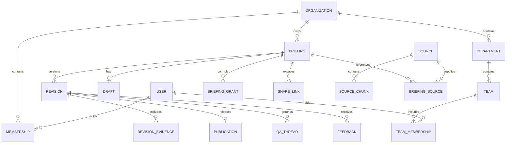

# Domain model and logical database schema

**Status:** Proposed logical schema, pending review. This is not an executable migration.

## Core entities

A **company** is the existing organization tenant. A company contains **departments**, each containing **teams**. Users may have multiple team memberships within an active company membership. See [TEAM_WORKSPACES.md](TEAM_WORKSPACES.md) for discovery and audience semantics.

A **briefing** is the stable identity of a communication. It owns a working draft, published revisions, access rules, and engagement history.

A **draft** is mutable and uses optimistic concurrency. A **revision** is a sealed content snapshot. A **publication** records the intentional release of a revision and can later be withdrawn without rewriting that snapshot.

A **source** is private authoring material. **Revision evidence** is an explicitly approved excerpt and safe attribution that readers of that revision may inspect. Access to evidence does not imply access to its original source.

An **evidence candidate** is an excerpt offered for reader evidence, from the LLM handoff or (in Phase 3) an imported file. It is stored with the draft and is pending, approved, or excluded. Only approved candidates become revision evidence at publication.

A **perspective** is an author-approved interpretation of relevance for an audience, stored in the revision document. It never grants or removes content access (D06). Author-written perspectives arrive through the handoff or manual editing; AI-suggested perspectives require explicit author adoption.

## Canonical document

The canonical document is a validated, schema-versioned JSONB value. It includes:

- Executive position and summary.
- Context and stakes.
- The intended decision, request, or outcome.
- Ordered sections and blocks with stable IDs.
- Authored rationale, assumptions, alternatives, tradeoffs, and uncertainty.
- References to approved evidence.
- Audience perspectives and their section emphasis or implications.
- Actions, owners, and dates when relevant.

Block types initially cover narrative, key finding, metric, comparison, chart, timeline, decision, risk, and action. Each type has a constrained payload. Rich text uses an allowed node vocabulary. Charts store data and an approved visualization specification, never executable scripts.

Stable block IDs support contextual questions, comments, analytics, and revision comparison. IDs survive edits to the same conceptual block; newly introduced blocks receive new IDs.

Draft references may point to private source selections and evidence candidates. Publication resolves approved candidates into a reader evidence package and validates every resulting reference; references to excluded or pending candidates fail validation. An empty evidence package is valid and renders the "no supporting evidence attached" state. Readers never receive draft-only provenance fields.

## Storage conventions

- Primary identifiers use UUIDs; timestamps use `timestamptz`.
- Tenant-owned rows include `organization_id`.
- JSON documents include a schema version and are runtime-validated.
- Relationship constraints include organization identity wherever the referenced resource is tenant-owned.
- Application status fields use constrained values with explicit transitions.
- Created and updated timestamps are included where relevant; immutable records do not support ordinary updates.

## Proposed tables

| Table | Principal fields and relationships |
| --- | --- |
| `users` | `id`, unique `auth_subject` from the active identity adapter (dev or Clerk, D08), profile fields; global identity |
| `organizations` | `id`, unique `slug`, name, settings |
| `memberships` | Organization, user, organization role (`owner`, `admin`, `member`), status; unique organization/user |
| `departments` | Organization, name, organization-scoped slug, archive timestamp |
| `teams` | Organization, department, name, department-scoped slug, archive timestamp |
| `department_memberships` | Organization, department, user, status; explicit department membership, unique department/user |
| `team_memberships` | Organization, team, user, status; unique team/user; requires company membership |
| `integration_connections` | Organization, user, authenticated client ID, identity-provider grant reference or dev/test connection-token hash (D08), permitted scope metadata, status, revocation; no plaintext credentials |
| `authoring_preferences` | Organization, user, default home department/team, preferred briefing style; unique organization/user; defaults reauthorized on use |
| `integration_operations` | Organization, actor, connection, tool action, idempotency key, input digest, status, resource/result references, error category, timestamps |
| `publication_previews` | Organization, briefing, actor, draft lock version, document/evidence digest, home/audience snapshot, expiry, consumption/publication reference |
| `invitations` | Organization, normalized email, intended membership or briefing grant, token hash, expiry, acceptance |
| `briefings` | Organization, owner, title, organization-scoped slug, home department/team, visibility, audience department/team, current publication, archive timestamp |
| `briefing_grants` | Organization, briefing, user, capability role (`owner`, `editor`, `publisher`, `reader`), optional revision scope, issuer, revocation |
| `briefing_drafts` | Organization, briefing, `document_json`, `schema_version`, `lock_version`, base revision, editor; evidence candidates with approval state are stored with the draft and covered by its lock version |
| `sources` | Organization, immutable object key or text reference, type, checksum, extraction status |
| `source_chunks` | Organization, source, text, page/slide/message locator, optional embedding and embedding model (populated only when an embedding provider is configured, T20) |
| `briefing_sources` | Organization, briefing, source, authoring-use metadata |
| `briefing_revisions` | Organization, briefing, sequential number, immutable document, schema version, content hash, creator |
| `revision_evidence` | Organization, revision, approved excerpt, safe source metadata, original locator, excerpt hash; only author-approved candidates |
| `publications` | Organization, briefing, revision, publisher, publication time, change summary, withdrawal time |
| `share_links` | Organization, briefing, optional pinned revision, token hash, access policy, expiry, revocation |
| `qa_threads` | Organization, briefing, revision, reader, selected perspective, visibility policy |
| `qa_messages` | Organization, thread, role, content, generation status, AI run reference |
| `answer_citations` | Organization, answer, revision, stable block ID or approved evidence ID |
| `feedback` | Organization, revision, optional block, author, type, text, status, resolution reference |
| `engagement_events` | Organization, revision, pseudonymous session, event type, block, time, deduplication key |
| `briefing_reads` | Organization, briefing, user, last opened revision number, last opened time; unique per (organization, briefing, user). A private per-user reading-state record that drives only the user's own library "Unread" / "New version" badges. RLS restricts rows to their own user; it is never author analytics and is separate from the pseudonymous `engagement_events` (migration 0005) |
| `engagement_insights` | Organization, briefing/revision, topic, counts, authorized supporting references, processing watermark |
| `ai_runs` | Organization, task, provider/model, prompt version, status, latency, usage, error category |
| `audit_events` | Organization, actor, action, target, revision, timestamp, limited metadata |
| `jobs` | Optional organization, job type, payload references, idempotency key, status, attempts, run-after time, claim metadata, error category; claimed with `FOR UPDATE SKIP LOCKED` (T07) |

Jobs are enqueued in the same transaction as the domain change that creates the work. Payloads carry resource references, not source text or model prompts. Retrieval indexes over published blocks and evidence are derived projections, keyed by organization and revision; they are not canonical content. Their implementation must preserve evidence provenance and access checks.

Source records also carry origin kind, connection reference when applicable, and optional host-provided attribution. A private conversation URL is attribution, not a fetchable source or evidence verification. Store transferred source content privately through the existing source pipeline. Provider-managed OAuth credential storage remains outside this logical application schema.

The connection's authorized company context and per-company authoring preferences resolve defaults. Selecting a default company across connections requires an explicit user preference; absent or stale context triggers clarification rather than a guessed destination.

### Home and audience fields

For company-level briefs, both home IDs are null. For department-level briefs, only `home_department_id` is set. For team-level briefs, both are set and a composite foreign key verifies that the team belongs to the stated department and organization.

Proposed visibility values are `company`, `department`, `team`, and `restricted`. A department audience requires `audience_department_id`; a team audience requires `audience_team_id`. Other audience IDs are null, enforced with row checks. Audience resources must belong to the same organization. Named-reader grants provide restricted access and explicit additional access.

Audience IDs are independent of home IDs. Moving a brief does not change its audience. Membership-derived reading applies only to released content. Department audience membership includes explicit department members and members of its teams; all require active company membership. These predicates must be enforced consistently in database policy and application services.

## Relationship overview

## Constraints and invariants

1. A briefing has at most one working draft. Draft writes compare and increment `lock_version`.
2. Revision numbers are unique within a briefing. A published revision is immutable through ordinary application credentials.
3. A publication references a revision of the same organization and briefing. A revision has at most one publication record.
4. A current-publication pointer resolves to a non-withdrawn publication of the same briefing.
5. Composite foreign keys prevent cross-tenant associations. Tenant-wide IDs alone are not sufficient protection.
6. A revision-scoped grant or link references a revision of its briefing.
7. Invitation tokens and share tokens are stored as hashes, with explicit expiry and revocation behavior.
8. JSON block and evidence references are validated transactionally at publication. Relational citations also receive foreign-key constraints where representable.
9. An answer's references belong to the answer's revision and authorized evidence set.
10. Feedback retains its original revision and block context even after later revisions change or remove the block.
11. Replacing a source creates a new immutable source record or version; it does not mutate evidence already published.
12. Retention-driven deletion is a distinct privileged operation governed by the agreed policy, not an ordinary revision edit.
13. Departments, teams, and their memberships cannot link different companies. Membership rows reference an existing company membership; authorization also checks its current active status.
14. Team home assignments must match their parent department. Briefing placement and audience changes are separate audited operations.
15. Integration operation keys are unique within organization, actor, connection, and action. The same key and digest return the original authorized result; a different digest is rejected. Creation/publication and their operation result are recorded atomically where applicable.
16. A publication preview binds to the exact draft version, evidence, home, and audience. Changes invalidate it; current publish permission is rechecked. The reference itself is not proof of human approval.
17. Connection revocation, expired authorization, or membership removal prevents subsequent integrated access. Retried results and status polling require fresh authorization.

## Indexing and evolution

Create indexes for organization/resource lookup, organization/user membership, briefing/revision number, active grants, and revision/time activity queries. Use unique constraints for slugs, tokens, and deduplication keys at the appropriate scope.

Add company/home department/home team/publication-time indexes for library views and company/owner indexes for author discovery. Search indexes cover titles and summaries; all search results and aggregate counts remain permission-filtered.

Index retrieval projections by organization and revision before optimizing vector search. Full-text search is the first retrieval path; vector search applies only when an embedding provider is configured (T20). Embeddings record their model and dimensions; changing embedding models requires an explicit reindexing plan.

Document schema versions are distinct from briefing revision numbers. Preserve older publications through compatible renderer adapters or explicit, validated read transformations without rewriting their canonical snapshots.
