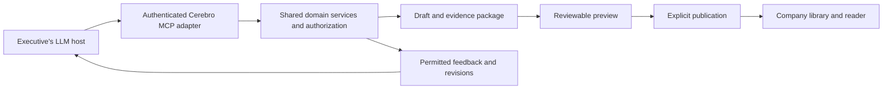

# Authoring and publishing from an LLM

**Status:** Primary authoring direction accepted by the user on 2026-10-22 (D02). Evidence approval and author-written perspectives in Phase 2, local connection tokens (D08), and the MCP transport (T21) were adopted 2026-10-22 to unblock implementation, at the user's direction to proceed on the planned defaults; revisit at architecture review. Host support and production authorization still require technical review.

## Product goal

Make **Send this to Cerebro** a first-class action inside the executive's existing LLM conversation. The executive develops their thinking there, reviews a structured briefing, and publishes it into the company workspace without transferring content manually between applications.

This integration is a core MVP capability alongside the reader and shared library. It precedes advanced in-app composition. The Cerebro studio remains available for deeper editing and a reliable manual workflow.

## Primary experience

1. Connect a Cerebro account through an authenticated account-linking flow.
2. Establish a default company and, optionally, a default department/team and briefing style.
3. Say: "Turn this into a Cerebro brief for the Platform team. Make it visible to the company."
4. Review a preview within the conversation when the host supports it.
5. Revise conversationally: "Tighten the recommendation, keep the tradeoffs, and add a finance perspective." The host writes the perspective's emphasis and implications and supplies it to Cerebro as author-written content (Phase 2). Cerebro-suggested perspectives arrive in Phase 3.
6. Publish the reviewed version with one explicit publication action, subject to the host's own permission controls.
7. Receive the canonical briefing link and published revision. Authorized colleagues discover it in company, department, and team views.

The preview identifies title, organizational home, audience, included sections, perspectives, each evidence candidate and its approval state, and any unresolved issues. Its primary actions are Preview brief, Keep as draft, and Publish. Saving a draft does not expose it to the publication audience.

## Defaults without hidden assumptions

- Resolve identity and permissible destinations from authenticated server context.
- Remember explicit company/team preferences; revalidate them on subsequent use.
- Keep organizational home separate from audience.
- Ask a concise question if a destination is ambiguous, no default exists, or a remembered preference is no longer authorized.
- Never guess between companies or silently broaden an existing brief's audience.
- Show the proposed audience before release, including when company-wide visibility is the default.
- Reuse the connected account until reauthentication is required; do not request credentials in the conversation.

## Structured handoff

The host supplies a versioned input package containing selected content and available source material. The package should preserve:

- The position, context, and requested decision.
- Rationale and alternatives considered.
- Assumptions, risks, uncertainty, and unresolved questions.
- Actions, owners, and dates where actually supplied.
- Source excerpts or attachment references that the host is permitted and able to transfer. Excerpts offered as reader evidence are candidate excerpts with attribution; none is approved on arrival.
- Author-written perspectives, each with its emphasis and implications, where the author asked for them.
- Proposed destination and audience, resolved to authorized IDs before mutation.
- A target briefing and expected draft version for updates.

The host may provide validated structured blocks or selected text for Cerebro to compose. Avoid an unnecessary rewrite if the supplied structured document already expresses the author's intent. Validation, rendering, provenance, and publication remain Cerebro responsibilities.

Cerebro cannot assume access to the complete chat, hidden model reasoning, all attachments, or a private conversation URL. Origin labels and source references supplied by the host are attribution metadata, not independent verification of a claim. Unavailable evidence remains an explicit gap.

Transfer only selected material. Private conversation excerpts remain private authoring sources until approved for the revision's reader evidence package. Do not import unrelated conversation history by default.

## Evidence approval

Minimal evidence approval is part of Phase 2, so the first published briefs carry only explicitly approved evidence.

1. The handoff supplies candidate excerpts. Each candidate starts unapproved.
2. Preview lists every candidate with its attribution and approval state.
3. The author approves or excludes each candidate, either conversationally through `update_brief_draft` or with per-excerpt toggles in the first-party preview. Approval changes alter the evidence digest and invalidate earlier previews.
4. At publication, only approved excerpts enter `revision_evidence`. Excluded and pending candidates remain private authoring material.
5. A brief can publish with zero approved evidence. The reader then shows an explicit "no supporting evidence attached" state rather than an empty or hidden panel.

Richer evidence selection from imported files follows in Phase 3 and reuses this approval contract.

## Integration architecture

Expose a remote MCP adapter over the same domain services used by the Cerebro web application. Keep the adapter in the initial application deployment unless operational requirements justify separation.

This incoming connection is distinct from Cerebro's outgoing model-provider adapters. Executives need not use the same LLM provider as Cerebro's background composition or reader Q&A.

## Proposed tool surface

Each mutation uses server-authorized IDs, validated input, and an idempotency key. Tool names below are proposed contracts, not implemented endpoints.

| Tool | Responsibility and important output |
| --- | --- |
| `get_authoring_context` | Return accessible companies, destination choices, saved preferences, and applicable authoring capabilities |
| `create_brief_draft` | Create a private draft from selected content, candidate excerpts, and author-written perspectives; return briefing ID, draft version, status, and validation issues |
| `get_operation` | Retrieve current authorized status and result for asynchronous capture/composition |
| `find_briefs` | Search accessible titles and metadata; narrow ambiguous update targets before editing |
| `get_brief` | Retrieve the authorized published revision or editable draft, with its version identity |
| `update_brief_draft` | Apply validated changes, including perspective edits and evidence approve/exclude decisions, against an expected draft version; return a conflict instead of overwriting newer work |
| `preview_brief` | Return the reader preview, home, audience, perspectives, each evidence candidate with its approval state, change summary, and expiring preview reference |
| `publish_brief` | Publish the exact reviewed draft and audience; return canonical URL, revision, and publication status |
| `get_author_feedback` | Return explicitly submitted questions and permitted aggregate insights; never raw private reader Q&A |

Tools should return meaningful errors for ambiguous destinations, expired authentication, denied access, missing evidence, conflicting edits, stale previews, rate limits, and failed asynchronous work. Unresolved content gaps are distinct from structural validation errors; do not fabricate support to clear either condition.

## Preview and publication integrity

The server records a preview binding to the organization, actor, briefing, draft version, document and evidence digest, organizational home, audience policy, and expiry. The reviewed audience includes explicit recipient grants where applicable.

Publication rechecks current permission and rejects a stale preview if relevant content, evidence, home, or audience has changed. Publication and its audit event remain one idempotent transaction.

A preview reference proves which content was prepared, not that a human approved it. A supported host must obtain an explicit publication instruction or present an authenticated publish action. Host confirmation behavior must be verified during integration testing. If a host cannot support the required review/action flow, use the first-party Cerebro publication surface.

Avoid redundant product confirmation steps after the exact content and audience have been reviewed and publication has been explicitly requested. Host or company policy may still require its own approval UI; do not promise to suppress it.

## Account linking and authorization

Per D08, connection authorization differs by environment:

| Environment | MCP connection authorization |
| --- | --- |
| Local development and tests | Connection tokens: high entropy, stored hashed, tied to an `integration_connections` row, created by the user in Settings, and revocable. Sent as a bearer credential in the transport, never in tool arguments |
| Production | OAuth account linking through an established MCP-compatible authorization server. Clerk's OAuth/MCP support is the first candidate; verification is pending |

Connection tokens are a dev/test stand-in only, not the production delegated-authorization design. Both paths map the authenticated subject to a Cerebro user, company membership, and current capabilities. OAuth scopes bound the integration's potential actions; they do not replace resource permissions.

A normal web login alone does not establish a delegated MCP authorization flow. Keep credential handling in the identity system, not in tool arguments, prompt text, or audit payloads.

Support revocation, expired-token recovery, company policy, and revalidation of membership. Connection metadata records client identity and the relevant grant or token reference. Do not build a custom production token issuer merely to avoid the compatibility review.

## Host experience and rollout

ChatGPT is a proposed first integration target, not an approved distribution commitment. Validate account availability, workspace policy, OAuth behavior, write permissions, file transfer, and distribution requirements before promising access.

The adapter uses `@modelcontextprotocol/sdk` over Streamable HTTP, served from a Next.js route at `/api/mcp` (T21).

An optional embedded MCP Apps interface for preview, destination/audience display, and publishing is deferred (T14). Until then, every client receives the text-only fallback: a structured summary and an authenticated preview link to the first-party preview, where evidence toggles and publication are available. It does not receive a false claim that the entire visual workflow can run inline.

Other MCP hosts require their own capability and permission tests. Do not infer universal compatibility from the protocol alone. Prefer capability detection to hard-coded assumptions about a host name.

## Continuing a briefing

An executive can say, "Update our Platform strategy with the rollout plan we just discussed." The integration resolves the intended briefing, retrieves its current editable version, proposes changes, and previews a revision comparison. It preserves the audience unless an explicit authorized change is requested.

Later, the executive can ask for submitted questions or permitted aggregate topics and draft a clarification. Private reader conversations remain outside the author-feedback tool. Publishing the clarification creates a new revision while prior answers and feedback retain their original context.

## Acceptance criteria

- Connect once, resolve an authorized destination, create a draft, review, and publish from a supported LLM host.
- Discover the resulting brief through company and team views without an additional manual upload.
- Retry a timed-out mutation without creating duplicate briefs or releases; reject reuse of an idempotency key with a different payload.
- Reject stale previews, conflicting edits, revoked connections, unauthorized destinations, and cross-company identifiers.
- Preserve source gaps, private material boundaries, and exact published revision identity.
- Publish only approved evidence candidates; excluded candidates never reach `revision_evidence`. A brief with no approved evidence shows the "no supporting evidence attached" state.
- Carry an author-written perspective from the handoff into the published revision.
- Update the same brief conversationally and show a useful diff before release.
- Retrieve submitted author feedback without exposing private Q&A.
- Demonstrate a clear fallback when embedded UI or attachment transfer is unavailable.

## Reference basis

Official OpenAI documentation reviewed on 2026-10-22 establishes the ChatGPT integration building blocks; it does not establish access for every account or compatibility with every host:

- [MCP server tools](https://developers.openai.com/plugins/build/mcp-server).
- [Embedded MCP Apps UI](https://developers.openai.com/plugins/build/chatgpt-ui).
- [Authenticated MCP integrations](https://developers.openai.com/plugins/build/auth).
