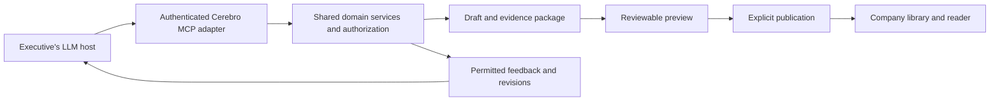

# Authoring and publishing from an LLM

**Status:** Primary authoring direction accepted by the user on 2026-10-22 (D02). Evidence approval and author-written perspectives in Phase 2, local connection tokens (D08), and the MCP transport (T21) were adopted 2026-10-22 to unblock implementation, at the user's direction to proceed on the planned defaults; revisit at architecture review. Host support and production authorization still require technical review. **Approved by the user on 2026-10-23 (D19).**

## Product goal

Make **Send this to Cerebro** a first-class action inside the executive's existing LLM conversation. The executive develops their thinking there, reviews a structured briefing, and publishes it into the company workspace without transferring content manually between applications.

This integration is a core MVP capability alongside the reader and shared library. It precedes advanced in-app composition. The Cerebro studio remains available for deeper editing and a reliable manual workflow.

## Primary experience

1. Connect a Cerebro account through an authenticated account-linking flow.
2. Establish a default company and, optionally, a default department/team and briefing style.
3. Say: "Turn this into a Cerebro brief for the Platform team. Make it visible to the company."
4. Review a preview within the conversation when the host supports it.
5. Revise conversationally: "Tighten the recommendation, keep the tradeoffs, and add a finance perspective." The host writes the perspective's emphasis and implications and supplies it to Cerebro as author-written content (Phase 2). Cerebro-suggested perspectives arrive in Phase 3.
6. Publish the reviewed version with one explicit publication action, subject to the host's own permission controls.
7. Receive the canonical briefing link and published revision. Authorized colleagues discover it in company, department, and team views.

The preview identifies title, organizational home, audience, included sections, perspectives, each evidence candidate and its approval state, and any unresolved issues. Its primary actions are Preview brief, Keep as draft, and Publish. Saving a draft does not expose it to the publication audience.

## Defaults without hidden assumptions

- Resolve identity and permissible destinations from authenticated server context.
- Remember explicit company/team preferences; revalidate them on subsequent use.
- Keep organizational home separate from audience.
- Ask a concise question if a destination is ambiguous, no default exists, or a remembered preference is no longer authorized.
- Never guess between companies or silently broaden an existing brief's audience.
- Show the proposed audience before release, including when company-wide visibility is the default.
- Reuse the connected account until reauthentication is required; do not request credentials in the conversation.

## Structured handoff

The host supplies a versioned input package containing selected content and available source material. The package should preserve:

- The position, context, and requested decision.
- Rationale and alternatives considered.
- Assumptions, risks, uncertainty, and unresolved questions.
- Actions, owners, and dates where actually supplied.
- Source excerpts or attachment references that the host is permitted and able to transfer. Excerpts offered as reader evidence are candidate excerpts with attribution; none is approved on arrival.
- Author-written perspectives, each with its emphasis and implications, where the author asked for them.
- Proposed destination and audience, resolved to authorized IDs before mutation.
- A target briefing and expected draft version for updates.

The host may provide validated structured blocks or selected text for Cerebro to compose. Avoid an unnecessary rewrite if the supplied structured document already expresses the author's intent. Validation, rendering, provenance, and publication remain Cerebro responsibilities.

Cerebro cannot assume access to the complete chat, hidden model reasoning, all attachments, or a private conversation URL. Origin labels and source references supplied by the host are attribution metadata, not independent verification of a claim. Unavailable evidence remains an explicit gap.

Transfer only selected material. Private conversation excerpts remain private authoring sources until approved for the revision's reader evidence package. Do not import unrelated conversation history by default.

## Evidence approval

Minimal evidence approval is part of Phase 2, so the first published briefs carry only explicitly approved evidence.

1. The handoff supplies candidate excerpts. Each candidate starts unapproved.
2. Preview lists every candidate with its attribution and approval state.
3. The author approves or excludes each candidate, either conversationally through `update_brief_draft` or with per-excerpt toggles in the first-party preview. Approval changes alter the evidence digest and invalidate earlier previews.
4. At publication, only approved excerpts enter `revision_evidence`. Excluded and pending candidates remain private authoring material.
5. A brief can publish with zero approved evidence. The reader then shows an explicit "no supporting evidence attached" state rather than an empty or hidden panel.

Richer evidence selection from imported files follows in Phase 3 and reuses this approval contract.

## Integration architecture

Expose a remote MCP adapter over the same domain services used by the Cerebro web application. Keep the adapter in the initial application deployment unless operational requirements justify separation.

This incoming connection is distinct from Cerebro's outgoing model-provider adapters. Executives need not use the same LLM provider as Cerebro's background composition or reader Q&A.

## Proposed tool surface

Each mutation uses server-authorized IDs, validated input, and an idempotency key. Tool names below are proposed contracts, not implemented endpoints.

| Tool | Responsibility and important output |
| --- | --- |
| `get_authoring_context` | Return accessible companies, destination choices, saved preferences, and applicable authoring capabilities |
| `create_brief_draft` | Create a private draft from selected content, candidate excerpts, and author-written perspectives; return briefing ID, draft version, status, and validation issues |
| `get_operation` | Retrieve current authorized status and result for asynchronous capture/composition |
| `find_briefs` | Search accessible titles and metadata; narrow ambiguous update targets before editing |
| `get_brief` | Retrieve the authorized published revision or editable draft, with its version identity |
| `update_brief_draft` | Apply validated changes, including perspective edits and evidence approve/exclude decisions, against an expected draft version; return a conflict instead of overwriting newer work |
| `preview_brief` | Return the reader preview, home, audience, perspectives, each evidence candidate with its approval state, change summary, and expiring preview reference |
| `publish_brief` | Publish the exact reviewed draft and audience; return canonical URL, revision, and publication status |
| `get_author_feedback` | Return explicitly submitted questions and permitted aggregate insights; never raw private reader Q&A |

Tools should return meaningful errors for ambiguous destinations, expired authentication, denied access, missing evidence, conflicting edits, stale previews, rate limits, and failed asynchronous work. Unresolved content gaps are distinct from structural validation errors; do not fabricate support to clear either condition.

## Preview and publication integrity

The server records a preview binding to the organization, actor, briefing, draft version, document and evidence digest, organizational home, audience policy, and expiry. The reviewed audience includes explicit recipient grants where applicable.

Publication rechecks current permission and rejects a stale preview if relevant content, evidence, home, or audience has changed. Publication and its audit event remain one idempotent transaction.

A preview reference proves which content was prepared, not that a human approved it. A supported host must obtain an explicit publication instruction or present an authenticated publish action. Host confirmation behavior must be verified during integration testing. If a host cannot support the required review/action flow, use the first-party Cerebro publication surface.

Avoid redundant product confirmation steps after the exact content and audience have been reviewed and publication has been explicitly requested. Host or company policy may still require its own approval UI; do not promise to suppress it.

## Account linking and authorization

Per D08, connection authorization differs by environment:

| Environment | MCP connection authorization |
| --- | --- |
| Local development and tests | Connection tokens: high entropy, stored hashed, tied to an `integration_connections` row, created by the user in Settings, and revocable. Sent as a bearer credential in the transport, never in tool arguments |
| Production | OAuth account linking through Clerk as the MCP authorization server (D13), the same Clerk instance as web sign-in. Resource-bound JWT access tokens and client registration (CIMD or DCR) were verified against Clerk's documentation and API specification on 2026-10-23; Clerk access tokens carry no `auth_time` (see below). Not yet exercised against a live Clerk instance or a production host |

Connection tokens are a dev/test stand-in only, not the production delegated-authorization design. Both paths map the authenticated subject to a Cerebro user, company membership, and current capabilities. OAuth scopes bound the integration's potential actions; they do not replace resource permissions.

A normal web login alone does not establish a delegated MCP authorization flow. Keep credential handling in the identity system, not in tool arguments, prompt text, or audit payloads.

Support revocation, expired-token recovery, company policy, and revalidation of membership. Connection metadata records client identity and the relevant grant or token reference. Do not build a custom production token issuer merely to avoid the compatibility review.

### Implemented auth contract (resource-server side, W2.2)

The authorization server is Clerk (D13). Cerebro implements the protected-resource side of the MCP authorization spec; Clerk issues the tokens, runs consent and registers clients. Setup steps and details are in `packages/integrations/README.md` ("Connect an LLM host via Clerk OAuth").

- **Metadata.** RFC 9728 metadata is served at `/.well-known/oauth-protected-resource/api/mcp`. It names the issuer configured in `CEREBRO_OAUTH_ISSUER` (Clerk's Frontend API URL), which is unset by default; while it is unset there is no metadata and every JWT is refused. A 401 carries `WWW-Authenticate: Bearer resource_metadata="…", scope="…"`. The JWKS is discovered from Clerk's `/.well-known/oauth-authorization-server`.
- **Tokens.** Access tokens are JWTs verified against the issuer's JWKS with asymmetric algorithms only. The token's `iss` must equal the configured issuer. Its `aud` must contain the MCP resource URL (`APP_URL` + `/api/mcp`); tokens for other resources are refused and never passed through. Clerk puts the RFC 8707 `resource` the host requested into `aud` only when the instance setting `aud_claim_enabled` is on; otherwise its tokens have no `aud` and are refused. The token also needs a valid `exp` and a `sub`. Tokens with an RFC 8693 actor (`act`) and opaque tokens (Clerk `oat_…`) are refused.
  - **Clerk profile** (`CEREBRO_OAUTH_PROFILE`, default `clerk`). Clerk signs session tokens and OAuth access tokens with the same keys and issuer, so the header `typ` must be `at+jwt`, and the client comes only from `client_id` (Clerk's `azp` is the frontend origin). This keeps a Clerk session token, even one with a custom `aud`, from being used as an MCP credential.
  - **Generic profile** (`CEREBRO_OAUTH_PROFILE=generic`) for another RFC 9068-style server: `typ` is not required, and the client may come from `azp`.
- **Identity.** `sub` maps to a Cerebro user only through an explicit identity link (`user_identities`: issuer + subject). Unknown subjects are refused. Clerk web sign-in creates these links with issuer = the session's `iss` (the Frontend API URL) and subject = the Clerk user id; Clerk OAuth tokens carry the same `iss` and `sub`, so the same Clerk user resolves to the same Cerebro user. A user must therefore sign in to the web app once before connecting a host. The web app logs `oauth.issuer_mismatch` if the session issuer differs from `CEREBRO_OAUTH_ISSUER`.
- **Grants.** Each grant is an `integration_connections` row with `kind = 'oauth'`, one per company, user, issuer and client. Grants are listed and revoked in Settings like connection tokens.
  - A revoked grant refuses tokens until the user authorizes again: the token's `auth_time` must be later than the revocation.
  - Clerk access tokens carry no `auth_time`, and Clerk refresh tokens do not expire, so a fresh authorization cannot be told apart from a refresh of the revoked grant. A revoked Clerk grant therefore stays refused (fail-closed). The user can reconnect it from Settings → Connections, an explicit and audited action in their web session. After that, only access tokens issued (`iat`) after the reconnection are accepted. Reconnecting trusts the client's existing refresh token again; to cut a host off for good, leave the grant revoked and remove or block the client in Clerk.
  - Clerk cannot revoke JWT access tokens. Cerebro enforces revocation itself on every request, and an issued token otherwise lives until `exp` (one day by default in Clerk).
  - Membership is rechecked on every request.
  - A grant binds to the user's only active company. Users with several companies get `company_selection_required` until a selection step exists.
- **Scopes.** `cerebro:read` covers context, finding and reading briefs, operations and feedback. `cerebro:draft` covers creating and updating drafts and previewing. `cerebro:publish` covers `publish_brief`. A missing scope returns HTTP 403 `insufficient_scope` and is rechecked per tool. Scopes never replace resource permissions.
- **Dev tokens.** Connection tokens (`cbr_`) carry all scopes. They stay refused in production unless `CEREBRO_ALLOW_DEV_CONNECTION_TOKENS=1`.

## Host experience and rollout

Claude is the first supported host and ChatGPT the next (D20). Neither is a distribution commitment yet. Validate account availability, workspace policy, OAuth behavior, write permissions, file transfer, and distribution requirements before promising access.

The adapter uses `@modelcontextprotocol/sdk` over Streamable HTTP, served from a Next.js route at `/api/mcp` (T21).

Every client receives the text-only fallback: a structured summary and an authenticated preview link to the first-party preview, where evidence toggles and publication are available. It does not receive a false claim that the entire visual workflow can run inline.

Hosts that support MCP Apps (extension `io.modelcontextprotocol/ui`, spec 2026-01-26) also get an inline preview (T14, W3.1). `preview_brief` and `publish_brief` link to the `ui://cerebro/brief-preview-v1.html` resource (`text/html;profile=mcp-app`). It is a self-contained document with no network access, and it renders the server-bound preview: title, position, request, home, audience in plain language, evidence counts and sections. Its Publish control asks for confirmation, then calls `publish_brief` through the host with only the server-issued `preview_id`. The preview binding stays the security boundary: a stale preview is refused exactly as it is for the model, and the view offers to preview again. Evidence decisions and audience changes still happen in Cerebro or through `update_brief_draft`. The stateless endpoint cannot see client capabilities when tools are listed, so it always advertises the UI metadata. The spec has hosts without the extension ignore that metadata, and the text result is unchanged. Details are in `packages/integrations/README.md`. The view has not yet been verified in a production host.

Other MCP hosts require their own capability and permission tests. Do not infer universal compatibility from the protocol alone. Prefer capability detection to hard-coded assumptions about a host name.

## Continuing a briefing

An executive can say, "Update our Platform strategy with the rollout plan we just discussed." The integration resolves the intended briefing, retrieves its current editable version, proposes changes, and previews a revision comparison. It preserves the audience unless an explicit authorized change is requested.

Later, the executive can ask for submitted questions or permitted aggregate topics and draft a clarification. Private reader conversations remain outside the author-feedback tool. Publishing the clarification creates a new revision while prior answers and feedback retain their original context.

## Acceptance criteria

- Connect once, resolve an authorized destination, create a draft, review, and publish from a supported LLM host.
- Discover the resulting brief through company and team views without an additional manual upload.
- Retry a timed-out mutation without creating duplicate briefs or releases; reject reuse of an idempotency key with a different payload.
- Reject stale previews, conflicting edits, revoked connections, unauthorized destinations, and cross-company identifiers.
- Preserve source gaps, private material boundaries, and exact published revision identity.
- Publish only approved evidence candidates; excluded candidates never reach `revision_evidence`. A brief with no approved evidence shows the "no supporting evidence attached" state.
- Carry an author-written perspective from the handoff into the published revision.
- Update the same brief conversationally and show a useful diff before release.
- Retrieve submitted author feedback without exposing private Q&A.
- Demonstrate a clear fallback when embedded UI or attachment transfer is unavailable.

## Reference basis

Official OpenAI documentation reviewed on 2026-10-22 establishes the ChatGPT integration building blocks; it does not establish access for every account or compatibility with every host:

- [MCP server tools](https://developers.openai.com/plugins/build/mcp-server).
- [Embedded MCP Apps UI](https://developers.openai.com/plugins/build/chatgpt-ui).
- [Authenticated MCP integrations](https://developers.openai.com/plugins/build/auth).

The inline preview was built against the MCP Apps extension specification, stable version 2026-01-26 (SEP-1865), reviewed on 2026-10-23: [`ext-apps/specification/2026-01-26/apps.mdx`](https://github.com/modelcontextprotocol/ext-apps/blob/main/specification/2026-01-26/apps.mdx). It uses the `@modelcontextprotocol/ext-apps` 1.7.x server helpers.

The Clerk authorization-server behavior was checked on 2026-10-23 against Clerk's documentation, its published API specifications and its SDK source. It has not yet been exercised against a live Clerk instance:

- [How Clerk implements OAuth](https://clerk.com/docs/guides/configure/auth-strategies/oauth/how-clerk-implements-oauth): issuer and metadata URL, endpoints, custom scopes, consent, DCR, token lifetimes and JWT access tokens by default.
- [Token formats](https://clerk.com/docs/guides/development/machine-auth/token-formats) and the [JWT access tokens changelog](https://clerk.com/changelog/2026-01-08-jwt-oauth-access-tokens): JWT versus opaque, and why JWTs cannot be revoked.
- [Connect MCP clients](https://clerk.com/docs/guides/ai/mcp/connect-mcp-client), [Client ID Metadata Documents](https://clerk.com/docs/guides/configure/auth-strategies/oauth/client-id-metadata-documents) and [Custom OAuth scopes](https://clerk.com/changelog/2026-08-21-custom-oauth-scopes).
- Clerk API specifications ([`clerk/openapi-specs`](https://github.com/clerk/openapi-specs), versions 2026-08-20): the `resource` parameter (RFC 8707) on `/oauth/authorize` and `/oauth/token`, and the instance settings `aud_claim_enabled`, `oauth_jwt_access_tokens`, `dynamic_oauth_client_registration`, `pkce_required`, `default_scopes` and `dynamic_client_allowed_scopes`.
- `@clerk/backend` 3.x source and fixtures ([`clerk/javascript`](https://github.com/clerk/javascript), `packages/backend/src/fixtures/machine.ts`, `src/jwt/verifyMachineJwt.ts`): OAuth access tokens have `typ: at+jwt`, `client_id`, `scope`, `jti` (`oat_…`), `sid` and `azp`, and no `auth_time`; audience matching (PR #9724).
