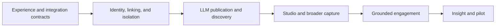

# Phased MVP implementation plan

**Status:** Sequence and acceptance gates. Implementation proceeds on the defaults adopted 2026-10-22 to unblock implementation, at the user's direction to proceed on the planned defaults; revisit at architecture review (D03–D09 and T07, T16–T22 in [RISKS_AND_DECISIONS.md](RISKS_AND_DECISIONS.md)). No phase is complete.

## Delivery approach

Build the connected authoring journey, reader, shared discovery, and trust boundaries before advanced in-app composition. The first product milestone is an executive connecting Cerebro, creating and reviewing a brief in their LLM, publishing it to an authorized home and audience, and having colleagues discover it immediately. Each phase requires explicit acceptance evidence. Calendar estimates depend on team capacity and the approved scope.

## Phase 0 — Experience and contract

**Deliver:** A representative strategy briefing, desktop/mobile reader prototype, connected-LLM preview and publication flow, structured handoff contract, document schema proposal, core design tokens, initial block vocabulary, and access matrix ([ACCESS_MATRIX.md](ACCESS_MATRIX.md)). Validate the proposed first host's capabilities, distribution path, and OAuth requirements. The prototype labels phase-gated surfaces, such as Ask/Q&A (Phase 4).

**Validate:** Position, stakes, and decision are clear; the sample fits the schema without arbitrary exceptions; home and audience are distinct in the integration preview; evidence gaps remain visible; unsupported host capabilities have honest fallbacks.

**Exit gate:** Approve the reader and connected-authoring experience, document/tool contracts, permission model, first host feasibility, and material product defaults. The five first-review questions have adopted defaults (D03–D07) that the review may revisit. Prototype artifacts are not production infrastructure.

## Phase 1 — Secure foundation

**Deliver:** Project setup with npm workspaces (T16) and strict TypeScript (T17), database migrations on PGlite and PostgreSQL (T18), authentication, company/department/team hierarchy, memberships, audience policies, grants, private storage, shared domain services, the PostgreSQL `jobs` queue (T07), CI, and basic observability. Authentication uses the dev identity adapter locally and in tests, with Clerk as the production web identity (D08). Establish connection lifecycle, MCP adapter foundations (T21), authorized destination resolution, and idempotent operation tracking. Locally, MCP connections use revocable connection tokens; production delegated account linking depends on the OAuth verification in D08.

**Validate:** Runtime-role database tests against real PostgreSQL demonstrate tenant isolation, denied access, membership revocation, and cross-tenant relationship rejection. Test the access matrix, integration scope boundaries, connection and token revocation, and ambiguous destination resolution. The dev sign-in page is unavailable unless `AUTH_MODE=dev`. A new environment can apply migrations predictably.

**Exit gate:** Authorized users can reach only permitted resources; the implementation has a repeatable local and test setup.

## Phase 2 — LLM-to-publication and company discovery

**Deliver:** Connected LLM draft creation from selected content, conversational edits, reader preview, explicit publication, canonical links, and update-existing-brief support. Include shared company library, department/team views, author filters, authorized title/summary search, My drafts, minimal manual editing with structured block forms (T22), optimistic conflicts, shared renderer, authenticated sharing, immutable history, and change summaries. Preserve source provenance.

Phase 2 also includes:

- **Minimal evidence approval.** The LLM handoff supplies candidate excerpts. Preview lists each candidate, and the author approves or excludes it through `update_brief_draft` or with per-excerpt toggles in the first-party preview. Only approved excerpts enter `revision_evidence`. A brief can publish with zero evidence; it then shows an explicit "no supporting evidence attached" state.
- **Author-written perspectives.** Perspectives supplied in the handoff or edited manually, carrying emphasis and implications over the same facts (D06).

Full file-format extraction, richer evidence selection, and AI-suggested perspectives follow in Phase 3.

**Validate:** An executive connects once, creates a private draft in a supported LLM, reviews content, evidence candidates, perspectives, and audience, and publishes; another company member discovers it and reads it on desktop/mobile. Repeat the workflow as an update to the same brief. Test duplicate requests, stale previews, changed audiences, changed evidence approvals, excluded excerpts absent from the published revision, the zero-evidence state, conflicting edits, and revoked access. Verify a text-only host fallback and manual editing/publication without a live model.

**Exit gate:** The complete supported-host LLM-to-publication-to-discovery journey works without manual content transfer. The first-party manual fallback also works independently of model availability.

**Hierarchy acceptance:** A member discovers another team's company-visible brief without a direct invitation; department views aggregate team briefs; author filters span homes; restricted briefs and drafts remain absent from unauthorized lists, counts, and search. Moving a brief preserves its audience. External invitees cannot browse the company workspace. Company admins cannot read drafts or restricted briefs without audience membership or a grant (D09).

## Phase 3 — Deeper studio editing and broader capture

**Deliver:** Deeper structured studio editing (Tiptap within structured blocks), pasted text/Markdown capture, PDF/DOCX/PPTX text extraction, extraction review, richer source provenance, Cerebro AI-proposed outlines and edits, richer evidence selection from imported files, and AI-suggested perspectives for author review. Reuse the existing draft, evidence-approval, and publication contracts across host and studio edits.

**Validate:** Representative sources become editable briefings with traceable evidence. Partial extraction is reported. AI results are schema-validated and cannot silently replace newer edits. AI-suggested perspectives are not published without explicit author adoption.

**Exit gate:** An author can turn imported thinking into a reviewed publication while recovering from import or provider failures.

## Phase 4 — Grounded engagement

**Deliver:** Published-revision retrieval projections (full-text first, T20), cited Q&A, private threads visible only to the asker (D07), explicit submitted feedback, usage limits, and insufficient-evidence behavior. Answers work with the deterministic local provider (T19). Expose submitted questions through the authorized author-feedback tool so an executive can draft a clarification in their LLM.

**Validate:** An evaluation corpus covers supported answers, abstention, citation support, stale revisions, prompt injection, and forbidden-source access. Missing indexes never cause fallback to a different revision. Authors and admins cannot read another reader's private Q&A.

**Exit gate:** Grounded-answer quality meets agreed pilot targets and access tests pass across retrieval and citations.

## Phase 5 — Author insight and pilot readiness

**Deliver:** Engagement views, aggregate recurring topics with cohort suppression, unresolved feedback, richer structured revision comparison, privacy controls, and operational hardening. Topic summaries are suppressed below a minimum cohort of 3 distinct readers, a provisional implementation setting (D07). Extend the author-feedback tool with permitted aggregate insights while keeping private Q&A inaccessible.

**Validate:** Representative end-to-end journeys, backup restoration, accessibility, latency, model cost, retention behavior, and privacy-preserving aggregate reporting, including suppression at the cohort boundary.

**Exit gate:** Pilot audience, hosting region, provider policy, production delegated authorization, retention, and analytics disclosure are approved. Measured readiness supports inviting real pilot users.

## Dependency chain

Design and evaluation preparation can overlap with implementation once their prerequisites are clear. Publication semantics and evidence permissions must be settled before reader Q&A is shipped.

## Test strategy

| Layer | Meaningful verification |
| --- | --- |
| Domain | Document validation, state transitions, access matrix permissions, draft conflicts, evidence approval, version comparison |
| Database | Composite tenant constraints, row policies under runtime credentials on real PostgreSQL, transactions, publication concurrency, job claiming |
| Integration | Identity resolution, dev identity gating, object access, extraction jobs, retry idempotency, projection lifecycle |
| LLM hosts | Connection tokens locally, OAuth linking in production, destination ambiguity, tool contracts, structured input, text-only fallback, stale previews, exact-audience publication, replay safety, connection revocation |
| Browser | Authoring, evidence approval, publication, sharing, reading, evidence inspection, contextual questions, feedback, revision changes |
| AI evaluation | Support, citations, abstention, injection resistance, revision grounding, deterministic provider behavior, provider regression |
| Feedback privacy | Author tools expose only submitted questions and permitted aggregates, never raw private Q&A; cohort suppression |
| Accessibility | Keyboard and screen-reader behavior, contrast, focus restoration, responsive reflow, chart alternatives |
| Operations | Restore test, failed-job recovery, rate limits, latency, cost visibility |

Test important behavior and failure modes rather than mirroring implementation details. Broaden testing when changes introduce a new risk or reveal an unresolved failure.

## MVP exclusions

Defer real-time collaborative editing, arbitrary slide layouts, organization-wide AI search, autonomous publishing, native mobile apps, elaborate approval chains, OCR, complex visual reconstruction, and administrator break-glass access (D09). MCP Apps embedded UI is deferred until host validation (T14). Revisit exclusions only through an explicit scope decision.

## Completion evidence

Each phase should record what was delivered, which acceptance checks ran, their results, and any remaining limitations. Update this plan with actual progress only when that evidence exists.

### First implementation pass — 2026-10-22

Delivered as a local, prototype-depth implementation. These are **not** pilot exit gates: architecture review, real identity/OAuth, the hosting, provider, retention and analytics decisions, and agreed quality targets are still outstanding.

| Phase | Delivered | Acceptance checks run | Remaining limitations |
| --- | --- | --- | --- |
| 0 | Representative strategy briefing fixture; document schema v1; LLM handoff contract v1 (with JSON Schema); design tokens with contrast tests; the 9-block vocabulary; `ACCESS_MATRIX.md`; desktop and mobile reader | Schema/fixture validation tests; renderer tests; contrast tests; Playwright reader on desktop and 390px mobile | First-host (ChatGPT) OAuth and distribution feasibility not reviewed; no design sign-off |
| 1 | Migrations, the `cerebro_app` runtime role, forced RLS, composite tenant foreign keys, Company → Department → Team, memberships, audiences, grants, invitations, the jobs queue, dev identity, connection tokens, destination resolution, idempotent operations | RLS and isolation tests under the runtime role; capability-matrix tests; cross-tenant sweep; revocation tests | Clerk and OAuth paths untested; no CI pipeline; the node-postgres path has not run against a live server |
| 2 | MCP tools (create/update/preview/publish/feedback); bound previews; one-transaction publish; library and discovery views; search; My drafts; minimal structured editor; conflicts; shared renderer; share links; history and diff; minimal evidence approval; author-written perspectives | MCP SDK client tests (in-process and against the live server); Playwright author journey, conflict, stale preview, share links, discovery scenarios and new brief | No MCP Apps embedded UI; text-only fallback only |
| 3 | PDF/DOCX/PPTX/text/conversation extraction with locators and gaps; sources panel; draft composition from a source; evidence from chunks | Capture format and safety tests; source and compose domain tests | No OCR; no AI-suggested perspectives or outlines, since no model is configured; local filesystem object store only |
| 4 | Retrieval projection from published blocks and approved evidence; revision-bound private Q&A; citation and support validation; preparing state; explicit feedback; author feedback tool | AI evaluation set (support, abstention, injection, numeric precision, foreign revision); security tests showing the private source never reaches answers | Deterministic extractive answers only; quality targets not agreed |
| 5 (partial) | Engagement summary with the cohort suppression set by D07; topic summaries; feedback resolution; unread indicators | Suppression and privacy tests; Playwright feedback loop | Backup restoration, latency and cost measurement, retention, and a full accessibility audit not done |

Commands: `npm test`, `npm run typecheck`, `npm run test:e2e`.

### Second implementation pass — 2026-10-23

Built on branch `remaining-work` against `REMAINING_WORK.md`. Vendor-neutral throughout: no hosting vendor, AI provider, storage vendor or OAuth server is selected, and no limit, retention period or target is set. These are still **not** pilot exit gates.

| Item | Delivered | Acceptance checks run | Remaining limitations |
| --- | --- | --- | --- |
| W1 | CI workflow; schema drift check; `E2E_PORT` | Drift test (it caught one real drift during merges) | CI not yet run on GitHub |
| W2.1 | `TEST_DATABASE_URL` test mode; pooled-connection leak regression test; owner privileges documented | Full Vitest suite and all Playwright journeys on PostgreSQL 17.6 with pgvector 0.8.1, with a separate worker processing jobs; `db:reset` then `db:migrate` is idempotent | Managed-host privileges unconfirmed; no PGlite-to-Postgres data move |
| W2.2 | Clerk mode with `user_identities` links (migration 0006); MCP OAuth protected resource with scopes and revocable grants | `oauth.test.ts` (token, audience, issuer, expiry, algorithm, scope, revocation, membership), `identity.test.ts` (Clerk mocked), RLS tests for 0006 | No Clerk keys; no authorization server chosen; no host verification |
| W2.3 | S3-compatible source store; organization-scoped get and delete | `s3-store.integration.test.ts` against MinIO built from source: roundtrip, immutable re-put, tamper detection, cross-tenant rejection, upload and extraction | Store vendor unselected |
| W2.4, W3.2, W3.3 | Provider wiring by environment; local embeddings; hybrid retrieval (off by default); AI suggestions (migration 0007) | `ai-resilience.test.ts` (reading, editing and publishing unaffected by provider failure); `suggestions.test.ts` (including the usage limit); `npm run ai:eval` (deterministic: 15/15 answer cases; retrieval MRR 0.639 full-text vs 0.694 hybrid on 18 fixture queries, with word-level embeddings only); `e2e/14-suggested-perspectives.spec.ts` | No real provider; no thresholds; the retrieval default is undecided |
| W3.1 | MCP Apps inline preview (spec 2026-01-26) | `mcp-apps.test.ts`; an AppBridge-hosted journey in `e2e/09-mcp.spec.ts` (stale preview refused, identifiers only, no network requests or CSP violations) | Not verified in a real host |
| W3.4 | Tiptap v3 prose fields within the existing `RichText` syntax | Round-trip unit tests over every fixture field; `e2e/12-rich-text.spec.ts`; conflict journey unchanged | — |
| W3.5 | Local OCR for scanned PDF pages and images | `ocr.test.ts` (recognised words, locators, limits as gaps, text-layer PDFs skip OCR); `e2e/13-ocr-upload.spec.ts`; `next build` | English only; limits provisional |
| W3.6, W4 | Cohort-suppressed withheld-question counts and topic requests; rate limits; AI usage limits; `/api/health` and `/api/ready`; allowlisted logger; retention and source hard delete (migrations 0008, 0009); `db:backup` / `db:restore`; `npm run perf` | `cohort.test.ts` (2 vs 3 readers), `ops.test.ts`, `retention.test.ts`, `backup.test.ts` and `postgres.test.ts` (backup → change → restore on both databases), `e2e/15-ops.spec.ts` | All limits and retention periods unset; no admin UI for them |

Security review of the production paths: 11 fixes, each with a regression test (D11), including a first-sign-in race that only the PostgreSQL test mode exposed.

Totals on the merged branch after the security fixes: typecheck clean; Vitest 678 passed (8 skipped) on PGlite and 681 passed (5 skipped) on PostgreSQL 17.6, three consecutive PostgreSQL runs; Playwright 37 passed (3 skipped) on PGlite and on PostgreSQL with a separate worker (15 jobs succeeded, none failed). Skips are the S3 integration test without an endpoint, and PostgreSQL-only tests in the PGlite run. The accessibility audit was removed from scope by the user.
